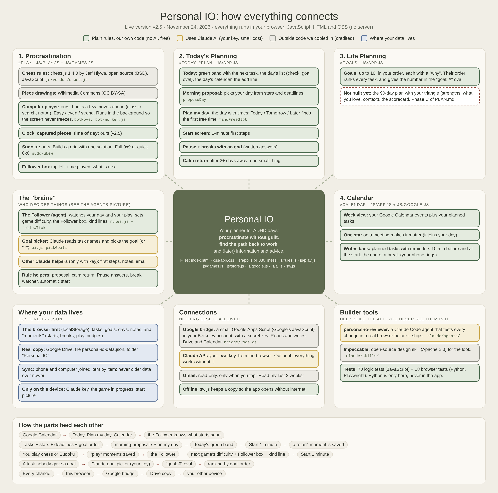
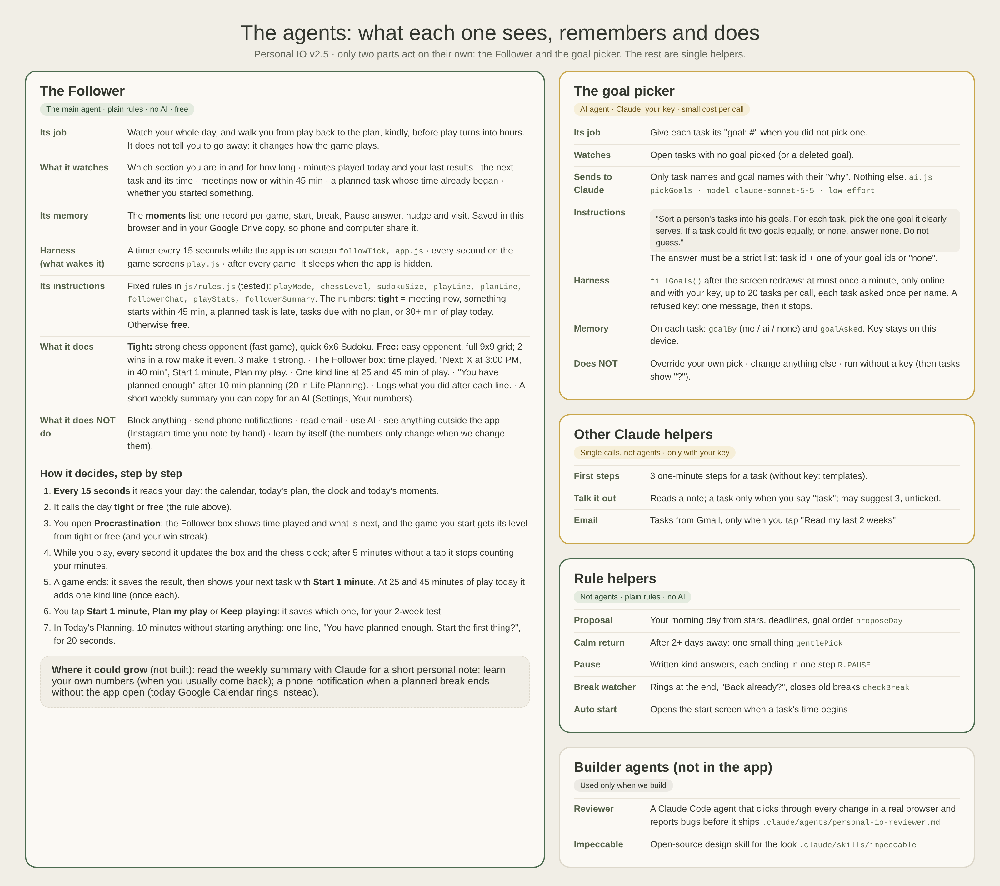

# Personal IO: the map of everything (v2.5, Nov 24, 2026)

Plain-words map of what is built, what code each part uses, and how the parts connect.
Pictures: `system-map.png` (everything) and `agents-map.png` (one card per agent).

## The languages

- **The app:** JavaScript, HTML and CSS only, running in the browser. No server, no build step.
- **The Google bridge:** Google Apps Script (Google's JavaScript), in his Berkeley account (`bridge/Code.gs`).
- **Data:** JSON, in the browser (localStorage) and in Google Drive (`personal-io-data.json`).
- **Python:** only for the browser tests (Playwright, `tests/e2e/`). Never in the app.

## The parts

| Part | Where | Code | Outside code | Agent? |
|---|---|---|---|---|
| Chess | `#play`, `js/play.js`, `js/games.js`, `js/bot-worker.js` | Our board, clock, captured pieces and computer player (a classic look-ahead search: easy 1 move deep, even 2, strong up to 6) | Rules of chess: chess.js 1.4.0 by Jeff Hlywa (BSD), `js/vendor/chess.js`. Pieces: Wikimedia Commons (CC BY-SA) | No. The Follower sets its strength |
| Sudoku | same | Our generator: a solved grid with numbers removed, one solution only. 9x9 or quick 6x6 | None | No. The Follower sets its size |
| Today | `#today`, `js/app.js` | Green band (`R.dayLine`), the day's list, the add line, morning proposal (`R.proposeDay`), calm return (`R.gentlePick`) | None | No (rule helpers) |
| Plan my day | `#plan` | The day with times; Today / Tomorrow / Later (`R.findFreeSlot`) | None | No |
| Start screen, Pause, breaks | `js/app.js` | 1-minute steps, written answers (`R.PAUSE`), break watcher (`checkBreak`) | None | No |
| Life Planning | `#goals` | Goals, ordered, with a why. 90-day triangle plan: not built yet (PLAN.md Phase C) | None | No |
| Calendar | `#calendar`, `js/google.js` | Week view, writes planned tasks and break ends | Google Calendar through the bridge | No |
| Saving and sync | `js/store.js`, `R.mergeData` | Browser first, Drive copy, phone and computer joined item by item | Google Drive through the bridge | No |
| Offline | `sw.js` | Keeps a copy so the app opens without internet | None | No |

## The agents

**The Follower** (main agent, plain rules, no AI, free)
- **Watches:** section and time there, play minutes and results today, next task and its time, meetings now or within 45 minutes, late planned tasks, whether something was started.
- **Memory:** the `moments` list (play, start, break, pause, nudge, visit), in the browser and in Drive.
- **Harness:** `followTick` every 15 seconds while the app is on screen (`js/app.js`), every second on game screens (`js/play.js`), after each game.
- **Instructions:** fixed, tested rules in `js/rules.js`: `playMode`, `chessLevel`, `sudokuSize`, `playLine`, `planLine`, `followerChat`, `playStats`, `followerSummary`, with the numbers in `FOLLOW` (45 min soon, 30 min a lot of play, lines at 25 and 45 min, 10 min planning, 20 min life planning).
- **Does:** sets game difficulty (tight: strong opponent, quick grid; free: easy, full grid, harder after win streaks), the Follower box, the kind lines, the over-planning line, logs what he did, a weekly summary to copy into an AI.
- **Does not:** block, notify the phone, read email, use AI, see outside the app, learn by itself.

**The goal picker** (AI, Claude with his key, small cost)
- **Watches:** open tasks with no goal picked, or a deleted goal.
- **Sends:** only task names and goal names and whys (`AI.pickGoals`, `js/ai.js`, claude-sonnet-5-5, low effort, strict JSON answer).
- **Instructions:** "pick the one goal it clearly serves; if two fit equally or none, answer none; do not guess".
- **Harness:** `fillGoals()` after a redraw, at most once a minute, online and with a key, each task once per name; a refused key shows one message and stops.
- **Memory:** `goalBy` (me / ai / none) and `goalAsked` on each task.
- **Does not:** override his own pick or change anything else.

**Other Claude helpers** (single calls, only with his key): first steps for a task, reading a "Talk it out" note, tasks from Gmail on request.

**Builder agents** (not in the app): `personal-io-reviewer` (`.claude/agents/`) tests every change in a real browser before it ships; the Impeccable design skill (`.claude/skills/impeccable/`).

## How the parts feed each other

- Google Calendar -> Today, Plan my day, Calendar -> the Follower knows what starts soon.
- Tasks, stars, deadlines, goal order -> morning proposal / Plan my day -> green band -> Start 1 minute -> a "start" moment.
- Chess or Sudoku -> "play" moments -> the Follower -> next game's difficulty, Follower box, kind line -> Start 1 minute.
- A task with no goal -> Claude goal picker -> "goal: #" oval -> ranking by goal order.
- Every change -> this browser -> Google bridge -> Drive copy -> the other device.
