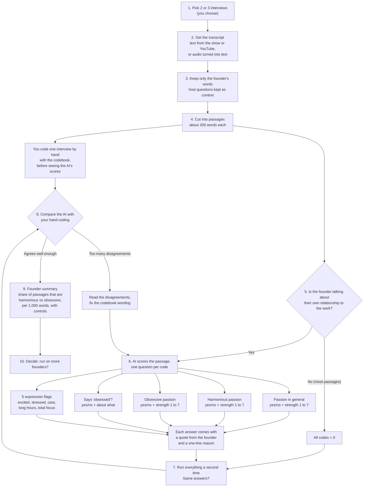

# Process map: from an interview to an obsession score

How the method works, for the pilot on 2 or 3 interviews. Nothing here is built yet; this is the plan for Phase 3.

## The steps in plain words

1. **Pick the interviews.** You choose 2 or 3. Long, relaxed conversations work better than 5-minute pitches.
2. **Get the transcript.** Ideally a text file you give me. If there is only audio or video, the pipeline turns speech into text (Whisper, running locally).
3. **Keep only the founder.** Host questions stay next to each answer, because a question like "What are you obsessed with?" invites that word. They are never scored.
4. **Cut into passages.** One answer is one passage. Long answers are cut at about 200 words, roughly one to two minutes of talk.
5. **First filter.** Is this passage about the founder's own relationship to the work? If it is only product or market talk, everything is 0. This keeps the AI from finding passion everywhere.
6. **Score with the codebook.** The AI gets one question per code, written in the same words as the codebook. Each answer must include the exact quote it relied on and a short reason, so you can check every score.
7. **Run it twice.** AI answers can vary a little between runs. If two runs disagree on a passage, that passage is flagged for you to look at.
8. **Compare with your hand coding.** You code one interview yourself first, without seeing the AI's answers. If the AI often disagrees with you, we read the disagreements and fix the wording.
9. **Founder summary.** For each founder: what share of their personal passages are harmonious, what share are obsessive, how often they say "obsessed" and about what. All per 1,000 words, so a founder who talks more does not score higher just for talking.
10. **Decide.** If the pilot works, run it on more founders. If not, we know why before spending more.

## What one scored passage looks like

| Question to the AI | Answer | Quote it used | Reason |
|---|---|---|---|
| About their own relationship to work? | Yes | "the problem kept on bugging me" | Talks about why he came back to build |
| Passion in general | Yes, 4 | "the problem kept on bugging me" | Strong pull toward the problem |
| Harmonious passion | No | | Nothing about choice or balance |
| Obsessive passion | Yes, 3 | "kept on bugging me... hedgehog into it" | An urge he could not put down, narrowing to one thing. Mild: no cost to the rest of life |
| Says "obsessed"? | No | | |

(Illustration only, built from the short Manny Medina quote in the Excel. The real answer depends on the full passage.)

## Where you come in

- **Before:** pick the interviews.
- **During:** code one interview by hand (about 90 minutes), before seeing the AI's scores.
- **After:** read the disagreements with me and decide whether the codebook needs changes.

## Cost

For 2 or 3 interviews the AI cost is small. Before any run I will test 5 passages and show you the results and an estimate for the whole pilot.
